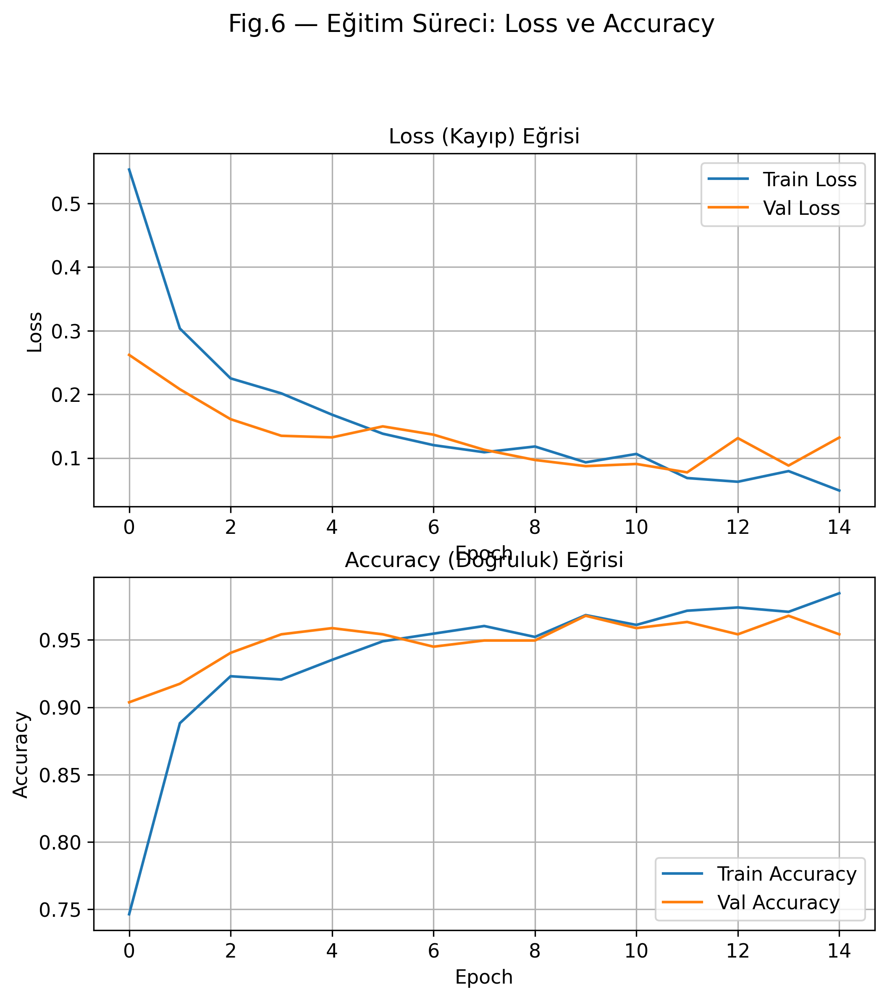
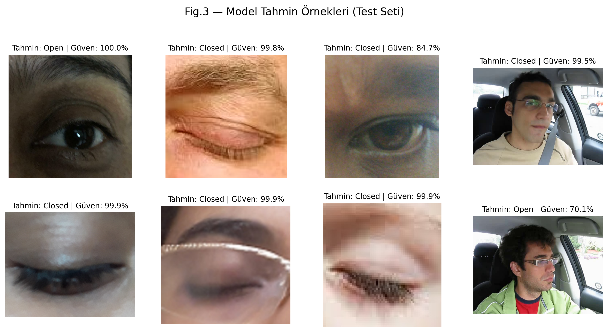
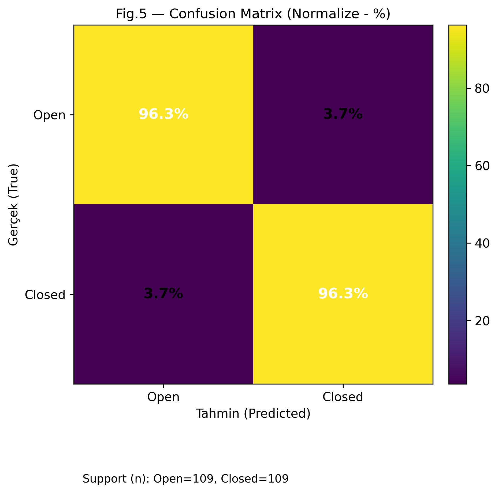

# Driver Drowsiness Detection System

A machine learning-based real-time driver drowsiness detection system using computer vision and eye-state classification.

The system monitors the driver's eyes through a camera, detects whether the eyes are open or closed, and triggers an audio warning when signs of drowsiness are detected.

## Features

- Real-time face and eye detection
- Eye-state classification using a trained deep learning model
- Automatic drowsiness detection
- Audio warning system
- Haar Cascade-based face and eye localization
- Training and evaluation visualizations

## Technologies

- Python
- OpenCV
- TensorFlow / Keras
- NumPy
- Haar Cascade Classifiers
- Machine Learning / Deep Learning
- Computer Vision

## Project Structure

- `run_realtime.py` – runs the real-time drowsiness detection system
- `train_eye.py` – trains the eye-state classification model
- `test_sound.py` – tests the warning sound
- `make_figures.py` – generates model and evaluation figures
- `models/` – trained model and training history
- `haar cascade files/` – Haar Cascade XML classifiers
- `figures/` – training results and evaluation visualizations
- `alarm.wav` – warning alarm sound

## Model Evaluation

The repository includes visualizations of the model's training process, predictions, and evaluation results.

### Training Curves



### Prediction Examples



### Confusion Matrix



## How It Works

1. The camera captures the driver's face in real time.
2. Haar Cascade classifiers detect the face and eye regions.
3. The trained model classifies the detected eye state.
4. The system monitors consecutive closed-eye detections.
5. If drowsiness is detected, an audio alarm is activated.

## Run the Project

Clone the repository and install the required Python dependencies.

Then run:

```bash
python run_realtime.py
```

A webcam is required for real-time detection.

## Author

**Mahyar Moghaddas**

M.Sc. Software Engineering
